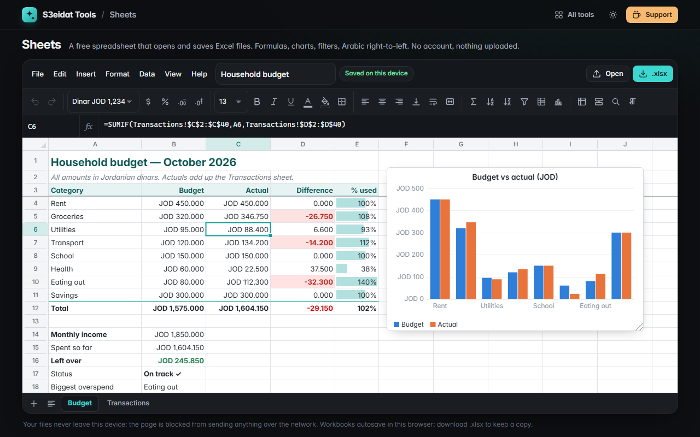

# Sheets

> A free, private spreadsheet that opens and saves Excel files. Formulas, charts, filters and Arabic right-to-left sheets, entirely in your browser.

### ▶ [Open Sheets](https://s3eidat.github.io/sheets/)



A free alternative to spreadsheet apps like Excel and Google Sheets for everyday single-user work:
budgets, lists, quick calculations and the .xlsx files people send you. No account, no subscription, no upload.

## Features

- **Fast grid**: only the visible cells are drawn, so 10,000+ row sheets scroll smoothly. Multiple sheets, frozen rows/columns, merged cells, resizable rows and columns (double-click a border to fit)
- **Formulas**: its own engine (no `eval`) with 150+ functions: SUM/AVERAGE/COUNTIF(S)/SUMIF(S)/AVERAGEIF(S)/MAXIFS, IF/IFS/IFERROR/SWITCH, VLOOKUP/HLOOKUP/XLOOKUP/INDEX/MATCH/XMATCH, text (TEXTJOIN, SUBSTITUTE, TEXT, SEARCH…), dates (DATE, EDATE, EOMONTH, NETWORKDAYS, DATEDIF…), finance (PMT, FV, PV, NPER, RATE, NPV, IRR, IPMT, PPMT) and dynamic arrays (UNIQUE, SORT, FILTER, SEQUENCE) that spill
- A1, ranges, `$` absolute references and cross-sheet references (`'My Sheet'!B2`); only dependent cells recalculate; circular references show `#CIRC!`; the usual errors (`#DIV/0!`, `#VALUE!`, `#REF!`, `#NAME?`, `#N/A`…) with an explanation
- Dates use the same 1900 serial numbers as other spreadsheet apps (including the historic 1900 leap-year quirk), so files round-trip correctly
- **Editing**: formula bar, function suggestions with signatures, click cells to insert references, fill handle (1, 2 → 3, 4…; Jan → Feb; Item 1 → Item 2; formulas shift), undo/redo, insert/delete rows and columns (formulas update), copy/paste as tab-separated text to and from other spreadsheet apps
- **Formatting**: number, currency (JOD with 3 decimals, $, €, £, SAR, AED), percent, dates, times, custom format codes; bold/italic/underline, colours, borders, alignment, wrap, merge
- **Data**: sort (multi-key), filter by values or condition, find and replace, remove duplicates, conditional formatting (greater/less/between/equal, text contains, blanks, duplicates, top N, custom formula, colour scales, data bars)
- **Charts**: column, bar, line, area, pie, doughnut and scatter, drawn by its own renderer; drag, resize, download PNG
- **Files**: open and save **.xlsx** (values, formulas, formats, merges, frozen panes, column widths, multiple sheets) and **.csv / .tsv**; print or save a range as PDF
- **Arabic**: right-to-left sheets, Arabic text in cells and sheet names
- **Autosave** in this browser (IndexedDB) with a list of your workbooks; works offline

## Privacy and safety

Your spreadsheets never leave your device. There is no server, no account, no analytics. The page ships with a
strict Content-Security-Policy (`connect-src 'self'`), so the browser itself blocks any attempt to send data anywhere.

Files are treated as untrusted: an .xlsx is checked (size, number of parts, zip-bomb ratios) before it is unpacked,
sheets are capped at 200,000 rows × 2,000 columns, macros and links to other files are ignored, and formulas are
read as text and run only by Sheets' own engine (which has no web, file or command functions). CSV cells that look
like formulas open as text, and CSV downloads prefix cells starting with `= + - @` so other apps don't run them.

## Limits (v1)

- One person at a time: no real-time collaboration, comments or sharing
- No macros, pivot tables, data connections or web functions
- Charts and conditional-format rules are written into the .xlsx in a hidden sheet so they come back when reopened here; other apps see the data and most rules, not the charts
- Dynamic-array formulas (UNIQUE, SORT, FILTER…) are saved as formulas; very old spreadsheet apps may show only their first value
- Old binary `.xls` files are not supported (save them as .xlsx or .csv first)

## Run it yourself

It's plain HTML, CSS and JavaScript with no build step:

```bash
git clone https://github.com/s3eidat/sheets
cd sheets
python -m http.server 8000
```

Then open http://localhost:8000.

Uses [ExcelJS](https://github.com/exceljs/exceljs) (MIT) for reading and writing .xlsx files.

## Support

If this saved you time, **[buy me a coffee ☕](https://s3eidat.github.io/coffee/)**. It keeps every tool free.

---

Part of **[S3eidat Tools](https://s3eidat.github.io/)**: 100+ free, private tools that run in your browser. MIT licensed.
